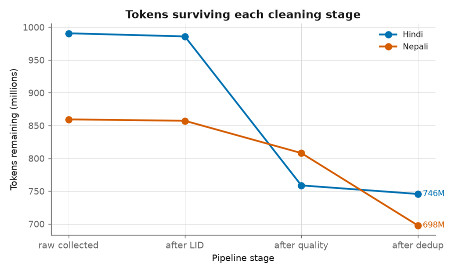
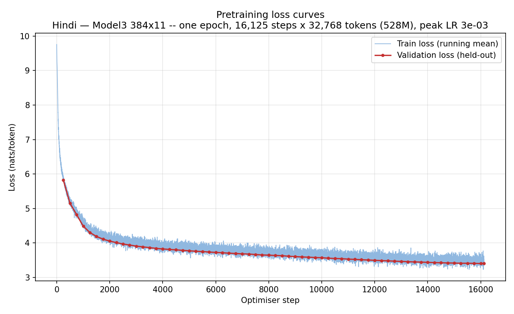
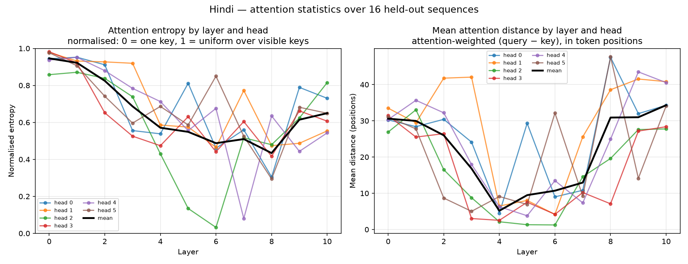
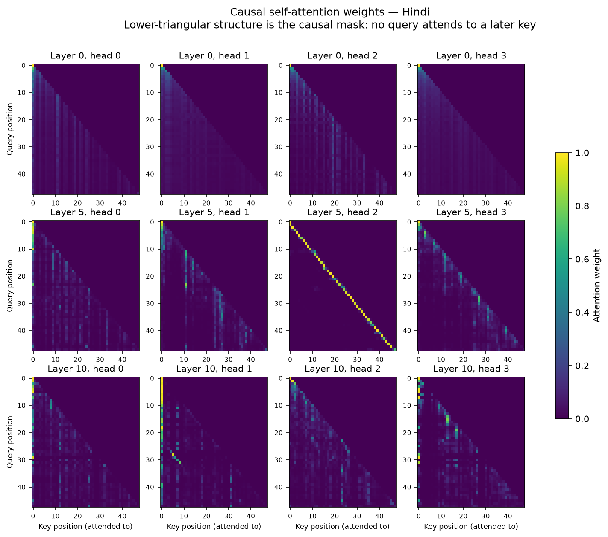
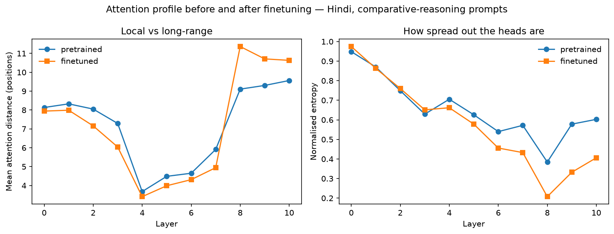
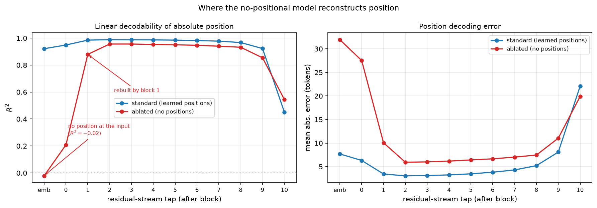

# Hindi Decoder LMs — GPT-style vs LLaMA-style

A ~26M-parameter Hindi language model, built from scratch, used as the fixed
baseline for one controlled question:

> **Does a LLaMA-style decoder (RoPE, RMSNorm, SwiGLU, no biases) improve
> copying-from-context and multi-hop chaining over a GPT-style decoder, or only
> perplexity?**

The GPT-style model is already trained and finetuned. It is **never retrained**.
The LLaMA-style model copies the GPT run's recorded recipe exactly: same data,
batch order, seed, token budget, schedule shape, batch size, context and precision.
Only the architecture changes.

Everything below is generated output kept in [`reports/`](reports/). Large
binaries such as checkpoints, token bins and corpora live in the gitignored
`artifacts/` folder; the [links](#artifacts-and-links) say where each one is published.

---

## Data & Tokenizer

| | |
|---|---|
| Corpus | ~2.1B characters of Hindi: 10 news sites crawled by us (21 % of tokens) plus Sangraha-verified Hindi and Hindi Wikipedia |
| Cleaning | Unicode normalisation, then a language-ID filter that keeps only Hindi, a quality filter and MinHash-LSH dedup: 1.71M → 1.46M documents |
| Splits (16K BPE tokens) | train **528,404,893** · val 35,779,979 · test 35,903,951; 0 exact train/held-out duplicates |
| Tokenizer | SentencePiece BPE, 16,000 vocab, byte fallback; 4.09 characters/token, 1.28 tokens/word |



Every pipeline step, plus checksums and storage locations, is described in
[`data/README.md`](data/README.md). The pipeline code in `data/pipeline/` is
**reference code**: the token files were built once and are not regenerated.

## GPT Pretraining

The baseline is a GPT-style decoder: d_model 384, 11 layers, 6 heads, context
512, learned absolute positions, pre-norm LayerNorm, GELU MLP (4×), tied
embeddings, dropout 0.1. It has **25,860,480 parameters**.

| Setting | Value |
|---|---|
| Tokens seen | 528,384,000 (16,125 steps × 32,768 tokens; batch 32 × 2 accumulation × 512) |
| Optimiser | AdamW (0.9, 0.95), weight decay 0.1, gradient clip 1.0, fp16 + GradScaler, single T4, 4.73 h |
| LR schedule | 750 warmup steps, then cosine decay to 0.1× peak |
| Peak LR | **3e-3**, swept with a bracket, so the optimum is interior |
| Final val loss | **3.4033** |

LR sweep (1,200 steps, 39.3M tokens per run):

| Peak LR | 1.5e-3 | **3e-3** | 4.5e-3 | 6e-3 |
|---|---:|---:|---:|---:|
| Val loss | 4.407 | **4.254** | 4.291 | 4.420 |



The train and val curves track each other for the whole run. This is one pass
over a 528M-token corpus, so there was little room to overfit.

## LM Evaluation

Full held-out test split; each of 35.9M tokens is scored exactly once.

| Model | CE (nats/token) | Perplexity | Bits per byte |
|---|---:|---:|---:|
| GPT-style 16K/384/11L | **3.4080** | **30.20** | **0.4892** |

The model needs about 0.49 bits per byte of Devanagari text. Bits per byte is
reported next to perplexity because it doesn't depend on the tokenizer.

## Generation Quality

200 held-out prefixes of 64 tokens each, with 128 generated tokens per prefix:

| Decoding | BLEU-4 | chrF2 | ROUGE-L | Distinct-1 | Distinct-2 | 4-gram repetition |
|---|---:|---:|---:|---:|---:|---:|
| Greedy | 2.31 | 13.48 | 9.47 | 0.051 | 0.117 | 0.818 |
| T = 0.5 | 2.84 | 17.53 | 11.82 | 0.094 | 0.303 | 0.428 |
| T = 1.0 | 2.46 | **20.29** | 10.72 | 0.237 | 0.785 | 0.008 |
| T = 1.5 | 0.72 | 16.83 | 5.52 | 0.359 | 0.979 | 0.000 |

Greedy decoding loops: 82 % of its 4-gram windows are repeats. T = 1.0 is the best
balance, with the highest chrF2 and almost no repetition. At T = 1.5 the text is
diverse but loses coherence. chrF2 is the metric to trust for Devanagari, because
BLEU's word tokenisation doesn't suit it.

## Attention Analysis

Per-head entropy and mean attention distance, measured on 16 test windows of 128 tokens:



- The early layers (0–2) are broad and near-uniform, with normalised entropy of 0.82–0.95.
- The middle layers become local and sharp. Layer 4 has a mean distance of 5.2 tokens, and head 6.2 attends a mean of 1.26 tokens back, a previous-token-style head.
- The late layers reach back across the whole window again. Head 8.5 has a mean distance of 47.7 tokens.
- The causal check confirms zero attention weight above the diagonal.



## Reasoning Finetuning

The task is synthetic transitive comparison ("A is taller than B, B is taller
than C…") with chain-of-thought targets. Entity names come from **disjoint
train/test pools** of 3,675 and 1,161 names. The model is trained at chain
depths 2–3; depths 4–6 and four domains are held out.

GPT-ft (`ft_60k`, the fixed baseline):
- 60,000 records, peak LR 3e-4, effective batch of 64 sequences, prompt-masked loss.
- Early stopping on exact match with held-out names; the best checkpoint is at step 1,000.
- **Held-out-name validation exact match 0.954.**

| Slice (held-out names) | Exact match | Chain correct |
|---|---:|---:|
| Pretrained base, any slice | 0.0 | 0.0 |
| In-domain, depth 2–3 | **95.9** | 93.2 |
| `rel_id_d23` (relation only) | 96.8 | 94.2 |
| In-domain, depth 4–6 (never trained) | 30.2 | **0.0** |
| Unseen domains, depth 2–3 | 52.5 | — |



- Copying names from the prompt works: copy rate is above 97.9 % on every slice.
- **Composition does not**: chain correctness is exactly 0 at every depth beyond the trained range.
- Finetuning made layers 1–7 more local and layers 8–10 longer-range and sharper.
- It also cost general language modelling. Perplexity on the pretraining test
  set rose from 29.1 to 172.8 (`reports/gpt_finetune/forgetting.json`).

## Ablation (no positional embeddings)

This is the same GPT recipe retrained with the positional table removed
(25,663,872 parameters). Details are in [`ablation/README.md`](ablation/README.md).

| Model | Test CE (2.05M-token prefix) | PPL | BPB |
|---|---:|---:|---:|
| Standard (learned absolute) | 3.3706 | 29.10 | 0.4833 |
| No positional embeddings | 3.3949 | 29.81 | 0.4868 |



Removing the table costs only 0.7 perplexity points. A causal mask is itself a
positional signal: a linear probe recovers absolute position from the ablated
model's residual stream with R² 0.96 by block 2, against −0.02 at the embedding
layer. As expected, a 1-layer model with no positional embeddings is exactly
permutation-invariant.

## GPT vs LLaMA

*Placeholder; filled in from Stage 2 onward.* The LLaMA-style decoder
(`model/llama.py`) uses RoPE, RMSNorm, SwiGLU with hidden size 1056, no biases,
the same 6-head multi-head attention and tied embeddings. That gives a
parameter count within +0.63 % of GPT. It is trained by the same
`train/pretrain.py` and `train/finetune.py` with `--arch llama` and evaluated by
the same scripts. Stage reports: [`reports/`](reports/).

---

## Repository layout

```
configs/      gpt_25m.yaml · pretrain_shared.yaml · finetune_shared.yaml   (values copied from the checkpoints)
model/        common.py (causal mask, generate, param count) · gpt.py · config.py · build_model factory
train/        pretrain.py · lr_sweep.py · finetune.py · finetune_sweep.py · hub.py   (--arch selects the decoder)
eval/         lm_metrics.py · generation_metrics.py · attention.py · reasoning_eval.py · reasoning_metrics.py · ...
viz/          plotting only (no computation)
data/         token_stream.py · sft_data.py · reasoning/ (generator) · pipeline/ (reference corpus code) · README.md
tokenizer/    hindi_bpe_16000.model / .vocab
ablation/     no-positional-embedding study
tests/        model checks (future-blindness, …) · overfit / kill-and-resume gates · baseline verification
kaggle/       kernel sources per GPU run
reports/      generated results: figures, tables, metrics JSON, RESULTS_*.md
artifacts/    (gitignored) checkpoints, token bins, corpus, finetuning data
```

## Reproduce

```bash
python -m venv .venv && .venv/bin/pip install -r requirements.txt

# place the artifacts (see links below):
#   artifacts/data/bin/{train,val,test}_16k.bin (+ .json sidecars)
#   artifacts/checkpoints/gpt/final_16k.pt
#   artifacts/checkpoints/gpt_ft/ft_60k/best.pt
#   artifacts/finetune_data/{train,validation,test}/hi/...

python -m tests.test_model_checks                      # CPU correctness checks
python -m tests.verify_gpt_baselines                   # test loss 3.4080, held-out EM 0.954
python -m eval.lm_metrics --split test                 # CE / PPL / BPB
python -m eval.generation_metrics                      # BLEU / chrF / ROUGE-L / Distinct / repetition
python -m eval.attention                               # heatmaps, entropy, distance
python -m eval.reasoning_eval --models pretrained,ft_60k
bash ablation/run_eval.sh                              # ablation suite
```

## Artifacts and links

| What | Where |
|---|---|
| Tokenizer | HF [`Prateek-Tiwari10/lma_phase1-tokenizer`](https://huggingface.co/Prateek-Tiwari10/lma_phase1-tokenizer) (Hindi folder) |
| GPT pretrained (`final_16k.pt`) | HF [`Prateek-Tiwari10/LMA_phase2` → `16k/hindi/`](https://huggingface.co/Prateek-Tiwari10/LMA_phase2/tree/main/16k/hindi) |
| GPT finetuned (`ft_60k`) | HF [`Prateek-Tiwari10/LMA_phase3` → `hindi/ft_60k/`](https://huggingface.co/Prateek-Tiwari10/LMA_phase3/tree/main/hindi/ft_60k) |
| Reasoning dataset | HF [`Prateek-Tiwari10/LMA_phase3_data`](https://huggingface.co/datasets/Prateek-Tiwari10/LMA_phase3_data) (`hi` folders) |
| Ablation model | HF [`Prateek-Tiwari10/LMA_bonus_nopos_hindi`](https://huggingface.co/Prateek-Tiwari10/LMA_bonus_nopos_hindi) |
| Token bins | Kaggle kernel output `prateek99491/lma-phase-2-export-bins-16k`; sha256 in [`data/README.md`](data/README.md) |
| LLaMA checkpoints | *added from Stage 4* |
